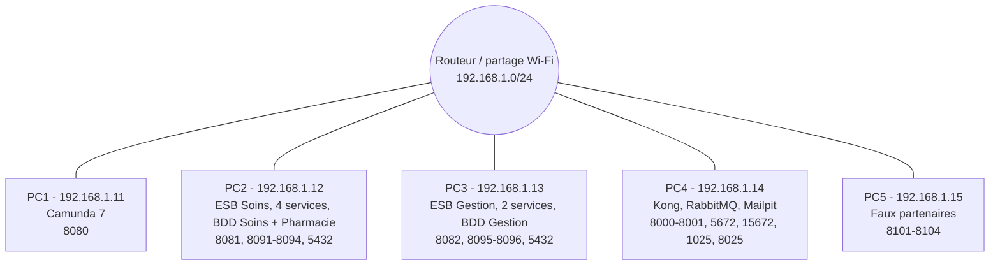

# Plan reseau de la demo

Source : [`interfaces.md`](../interfaces.md) section 1. Un seul routeur ou partage de connexion Wi-Fi,
sous-reseau `192.168.1.0/24`, chaque PC en IP fixe.



## 1. IP fixe (sur chaque PC, le jour J)

Parametres Windows > Reseau > Wi-Fi > Modifier l'attribution IP > Manuel (IPv4) :

| Champ | Valeur |
|---|---|
| Adresse IP | celle du PC (`192.168.1.11` a `.15`) |
| Masque | `255.255.255.0` |
| Passerelle | l'adresse du routeur (a relever sur place, souvent `192.168.1.1`) |

Si le sous-reseau du routeur n'est pas `192.168.1.x`, il faut changer `interfaces.md` ET annoncer le changement
au groupe : le routeur ou le partage de connexion doit etre regle sur `192.168.1.0/24`.

## 2. Pare-feu

PowerShell en administrateur, dans `infra/scripts/`, une fois par PC :

```powershell
.\pare-feu.ps1 -Pc PC2        # PC1, PC2, PC3, PC4 ou PC5 selon le PC
```

Le script ouvre les ports TCP du PC (liste ci-dessus) et autorise le ping, sur tous les profils reseau
(Windows classe souvent le Wi-Fi de demo en "Public"). `-Remove` retire les regles.

## 3. Demarrer les composants d'infrastructure

Dans `infra/`, apres `copy .env.example .env` :

| PC | Commande | Demarre |
|---|---|---|
| PC2 | `docker compose --profile pc2 up -d` | PostgreSQL (BDD soins + pharmacie) |
| PC3 | `docker compose --profile pc3 up -d` | PostgreSQL (BDD gestion) |
| PC4 | `docker compose --profile pc4 up -d` | RabbitMQ + Mailpit |
| un seul PC (plan B) | `docker compose --profile all up -d` | tout |

Si un PostgreSQL deja installe sur Windows occupe le port 5432, mettre `POSTGRES_PORT=5433` dans le `.env`
de ce PC (voir aussi la note ci-dessous).

## 4. Test de connexion

Depuis n'importe quel PC, dans `infra/scripts/` :

```powershell
.\test-reseau.ps1          # reseau de demo : ping + ports de chacun des 5 PC
.\test-reseau.ps1 -Local   # plan B : tout sur localhost
```

Chaque ligne affiche OK ou KO. Un port KO est normal tant que l'equipe concernee n'a pas lance son service ;
un PC entier en KO (ping compris) signale un probleme de reseau, d'IP ou de pare-feu.

Le test est a faire une fois par PC, avant la repetition.

## Pieges connus

- **Port deja pris** par un PostgreSQL ou un RabbitMQ installe sur Windows : voir ci-dessous.
- **Wi-Fi "Public"** : sans le profil `Any` des regles, le pare-feu bloque quand meme. Le script en tient compte.
- **Wi-Fi invite / isolation des clients** : certains routeurs empechent les PC de se parler. Utiliser un partage
  de connexion d'un telephone ou desactiver l'isolation.
- **Docker Desktop doit etre lance** avant `docker compose up`.

## Port deja utilise (PostgreSQL / RabbitMQ installes sur Windows)

Si un PostgreSQL (port 5432) ou un RabbitMQ (5672, 15672) est deja installe sur le PC, c'est lui qui repond
a la place du conteneur : erreur "password authentication failed" ou "Login failed" avec `medilink/medilink`.

Verifier qui ecoute (PowerShell) :

```powershell
Get-NetTCPConnection -State Listen -LocalPort 5432,5672,15672
```

Deux solutions :

1. **Arreter le service Windows** (PowerShell en administrateur), puis relancer le conteneur :
   ```powershell
   Stop-Service RabbitMQ          # ou : Stop-Service postgresql-x64-16 (nom a verifier avec Get-Service *postgres*)
   ```
   Pour le remettre : `Start-Service RabbitMQ`.
2. **Changer le port du conteneur** dans `infra/.env` (fichier local, non versionne), par exemple
   `POSTGRES_PORT=5433`, puis `docker compose up -d`. Eviter les ports 15673-15772 (reserves par Windows,
   verifier avec `netsh int ipv4 show excludedportrange protocol=tcp`).

Si une page RabbitMQ affiche `disable_stats is not defined` apres le changement : vider le cache du navigateur
(Ctrl+F5 ou fenetre privee).
